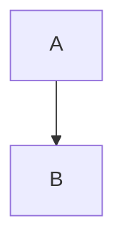

# Markdown Graph Renderer — Architecture

## The Core Idea

Mermaid works by **hijacking fenced code blocks** with a special language tag:

````markdown

````

The markdown parser treats this as an opaque code block. A post-processing step
intercepts the `mermaid` language tag and passes the raw text to Mermaid.js,
which renders an SVG in its place.

We do **exactly the same thing** for data charts, using `chart:<type>` as the
language tag and JSON as the data format.

---

## Full Pipeline

```
Raw Markdown Text
       │
       ▼
┌──────────────────┐
│   marked.js      │  (or remark, markdown-it, …)
│  custom Renderer │◄── We replace the `code()` method
└──────────────────┘
       │  code block with lang = "chart:line" → intercept
       ▼
┌──────────────────────────────────────┐
│   renderer.js  (our code)            │
│                                      │
│  1. Parse lang tag  →  chart type    │
│  2. JSON.parse(body) → spec          │
│  3. Build Chart.js config object     │
│  4. Emit  <canvas id="…">  +         │
│           <script>new Chart(…)</script>│
└──────────────────────────────────────┘
       │
       ▼
  HTML string (injected into DOM)
       │
       ▼
┌──────────────────┐
│   Chart.js       │  Renders on <canvas> at runtime
│ (+ box plugin)   │
└──────────────────┘
```

---

## Fenced Block Syntax

````markdown
```chart:<type>
{ ...JSON spec... }
```
````

| Tag             | Chart type                        |
|-----------------|-----------------------------------|
| `chart:line`    | Line chart                        |
| `chart:bar`     | Bar / grouped bar chart           |
| `chart:pie`     | Pie chart                         |
| `chart:doughnut`| Doughnut chart                    |
| `chart:scatter` | Scatter plot                      |
| `chart:hist`    | Histogram (auto-bins raw values)  |
| `chart:box`     | Box plot (5-number summary)       |

---

## JSON Spec Fields

### Common fields (all chart types)
| Field         | Type     | Description                         |
|---------------|----------|-------------------------------------|
| `title`       | string   | Chart title shown above the chart   |
| `xLabel`      | string   | X-axis label                        |
| `yLabel`      | string   | Y-axis label                        |
| `beginAtZero` | boolean  | Force Y-axis to start at 0          |
| `width`       | string   | CSS max-width of wrapper div        |
| `options`     | object   | Raw Chart.js `options` override     |

### `chart:line` / `chart:bar` / `chart:scatter`
```json
{
  "title": "My Chart",
  "xLabel": "X",
  "yLabel": "Y",
  "data": {
    "labels": ["A", "B", "C"],
    "datasets": [{ "label": "Series 1", "data": [1, 2, 3] }]
  }
}
```

### `chart:pie` / `chart:doughnut`
```json
{
  "title": "Market Share",
  "legendPosition": "right",
  "data": {
    "labels": ["Chrome", "Safari", "Firefox"],
    "datasets": [{ "data": [65, 18, 4], "backgroundColor": ["#0070f3","#34aadc","#f5a623"] }]
  }
}
```

### `chart:hist`
```json
{
  "title": "Score Distribution",
  "bins": 10,
  "values": [42, 55, 60, 71, 72, 80, 85, 90, 95]
}
```
`values` is a flat array of raw numbers. The renderer auto-bins them.

### `chart:box`
```json
{
  "title": "Box Plot",
  "data": {
    "labels": ["Group A", "Group B"],
    "datasets": [{
      "label": "Scores",
      "data": [
        [10, 20, 30, 40, 50],
        [15, 25, 35, 45, 55]
      ]
    }]
  }
}
```
Each inner array is auto-converted to a 5-number summary (min, Q1, median, Q3, max).

---

## Library Choices

| Library | Role | Why |
|---------|------|-----|
| **marked.js** | Markdown parser | Lightweight, easy custom renderer hook |
| **Chart.js v4** | Canvas-based charts | Excellent line/bar/pie/scatter support |
| **@sgratzl/chartjs-chart-boxplot** | Box plot plugin for Chart.js | Adds `boxplot` chart type |

### Alternatives considered

| Alternative | Pros | Cons |
|-------------|------|------|
| **D3.js** | Maximum flexibility, SVG-based | Very verbose, steep learning curve |
| **Vega-Lite** | Declarative JSON grammar, powerful | Large bundle, less Chart.js-compatible |
| **Plotly.js** | Rich scientific charts | Heavy bundle (~3 MB) |
| **remark** | AST-based, composable plugins | More setup than marked.js |

---

## Extension Points

### 1. Add a new chart type
In `renderer.js`, add a new `case` in the `switch(chartType)` block:

```js
case 'radar': {
  chartConfig = {
    type: 'radar',
    data: spec.data,
    options: { ... }
  };
  break;
}
```

### 2. Switch the markdown parser
Replace `setupMarked()` with an equivalent for remark or markdown-it:

**remark** (via `remark-rehype` pipeline):
```js
import { visit } from 'unist-util-visit';
function remarkChartPlugin() {
  return (tree) => {
    visit(tree, 'code', (node) => {
      if (node.lang?.startsWith('chart:')) {
        const type = node.lang.slice('chart:'.length);
        node.type = 'html';
        node.value = renderChartBlock(type, node.value);
      }
    });
  };
}
```

**markdown-it**:
```js
md.options.highlight = (code, lang) => {
  if (lang?.startsWith('chart:')) {
    return renderChartBlock(lang.slice('chart:'.length), code);
  }
  return '';
};
```

### 3. Server-side rendering (Node.js)
Use `canvas` (npm) + `chart.js` to render to PNG/SVG at build time instead of
emitting `<canvas>` + `<script>` tags.

```js
const { createCanvas } = require('canvas');
const { Chart } = require('chart.js');

const canvas = createCanvas(700, 400);
const ctx = canvas.getContext('2d');
new Chart(ctx, chartConfig);
const png = canvas.toBuffer('image/png');
// Embed as 
```

---

## Security Note

User-supplied JSON spec is parsed with `JSON.parse()`, which is safe (no `eval`).
The resulting `chartConfig` object is serialized back to JSON and injected into a
`<script>` tag — ensure the renderer runs in a trusted context (not user-facing
comment boxes) or sanitize the output with DOMPurify before insertion.
